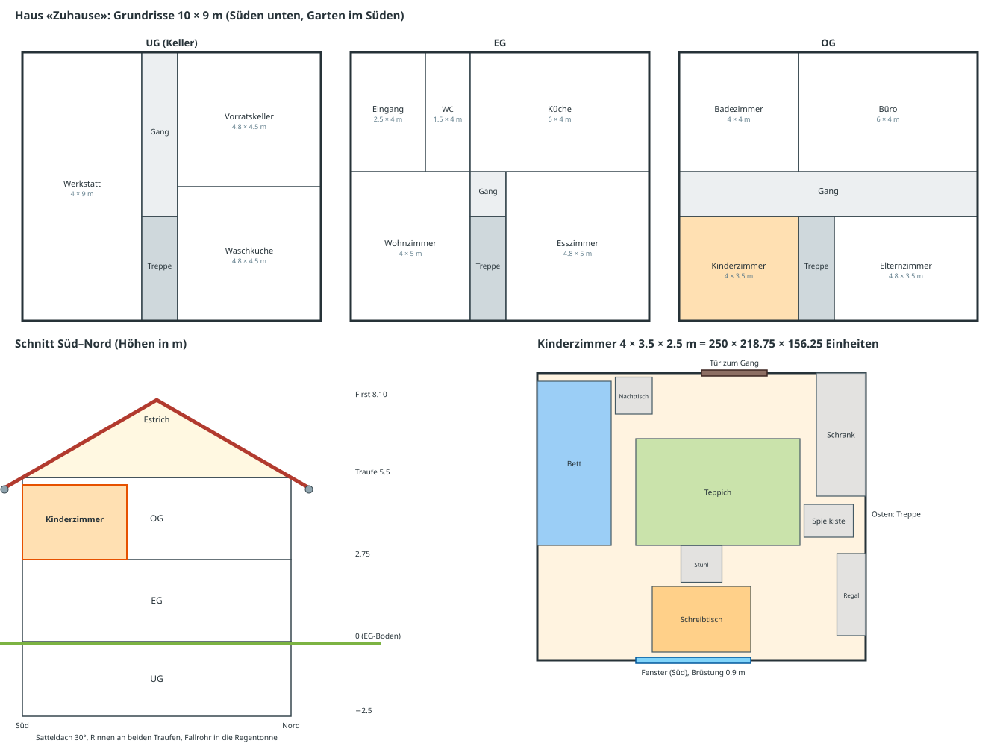

# Plan: Echte Orte statt Bahn im Leeren (#84)

Ziel: Ein Level ist ein Weg durch einen echten Ort. Die Kulisse ist der Ort, die Hindernisse sind Dinge dieses Ortes,
das Material verändert das Fahren.

**Entscheid (Benutzer):** Die echten Orte sind eine neue Kategorie im ganzen Spiel. Die bisherigen Strecken werden nicht
verändert.

## 1. Stand (geprüft im Code)

| Wo | Kulisse | Bahn |
|---|---|---|
| main, alle Welten | `theme.ground(tools, floorY)`: eine Ebene bei `floorY = killY - 1` (`src/view.js:282`) und `scatter()` (`src/themes.js:80`): 26 Gegenstände im Ring 14–69 m um (0, -25), unabhängig vom Level, so verkleinert, dass sie unter der Bahn bleiben | allgemeine Teile (`weg`, `rinne`, `klotz` …) mit Welt-Material |
| #79 Winter, #80 Chilbi, #82 Werkstatt, #83 Schweiz | gleiches Muster: Ebene + `scatter` + Deko-Klötze. Kein Raum, keine Wände, kein Dach | allgemeine Teile neu eingefärbt; neue Oberflächen `schnee`, `zuckerwatte`, `saegemehl`, `schoggi` |
| #78 Dach (`d1`) | einziger echter Ort: `level.haus` baut Hauswände, Giebel, hintere Dachfläche, Garten, Nachbarhäuser (nur Grafik) | allgemeine Teile, aber nach dem Haus gelegt (Neigung 0.5 = `haus.neigung`); Oberflächen `ziegel`, `dachrinne` |

Grössen der Level auf main (Ausdehnung der Teile, gemessen): 8–56 m breit, 37–138 m lang (`b1` am längsten).
Kamera: `far` 200, Nebel je Welt z. B. 50–120 (Spielzimmer).

## 2. Massstab

**Entscheid (Benutzer):** Die Murmel ist so gross wie echt. Für alle echten Orte gilt darum **1 Einheit = 1.6 cm**
(Murmel Ø 1 Einheit = 1.6 cm, `R = 0.5`). Alles andere wird in echten Massen gebaut und umgerechnet (cm / 1.6):

| Ding | echt | Einheiten |
|---|---|---|
| Tischplatte | 120 × 80 cm, 75 cm hoch | 75 × 50, 46.9 hoch |
| Zimmer | 4 × 3.5 × 2.5 m | 250 × 218.75 × 156.25 |
| Haus wie in `d1` (#78) | 4.8 × 8.3 m | 300 × 518.75 |
| Fallrohr 3 m | 3 m | 187.5 |

Folgen (berechnet):
- **Strecken liegen auf Möbeln, nicht quer durchs Zimmer.** Die heutigen Level sind 37–138 Einheiten lang, das sind
  0.6–2.2 m echt: eine Tischplatte, ein Regal, ein Stück Dach. Der Rest des Raums ist Kulisse.
- **Kamera:** `far` 200 reicht im Zimmer nicht, die Raumdiagonale ist 367 Einheiten. Für Level mit `ort` `far` und Nebel
  aus der Grösse des Orts setzen.
- **Physik bleibt** (`G = 9.82` Einheiten/s², gleich wie alle Level, Autopilot und die 16 Kombinationen). Weil eine Einheit
  1.6 cm statt 1 m ist, läuft alles wie in Zeitlupe, Faktor √(100 / 1.6) = 7.9: Ein Fall von der Tischplatte dauert im
  Spiel 3.09 s, echt 0.39 s. Das passt zum Gefühl «klein sein in einem grossen Raum» (wie *Tinykin*). Die Schwerkraft
  62.5-mal stärker zu machen, wäre echt schnell, aber nicht mehr steuerbar.
  **Entscheid (Benutzer):** vorerst so lassen (Physik wie im Original). Später verfeinern, je nach Höhe der Strecke;
  dafür gibt es schon `level.physik.schwerkraft` pro Level.
- **`d1` (#78)** rechnet mit 25 cm pro Einheit. Für die Kategorie muss es im neuen Massstab neu gebaut werden: Das Haus
  wird 15.6-mal grösser (25 / 1.6), die Strecke deckt nur noch ein Stück Dach ab (z. B. letzte Ziegelreihen → Dachrinne → Fallrohr →
  Regentonne).

## 3. Technik

### 3.1 `ort` an der Welt
- Neues Modul `src/orte.js` mit Bauern je Art: `raum`, `haus`, `tisch` (alle neu, `level.haus` aus #78 nur als Vorlage).
- Die Welt beschreibt den Ort als Daten in echten cm, der Bauer rechnet in Einheiten um, z. B.
  `ort: { art: 'raum', cm: [400, 250, 350], moebel: [{ art: 'tisch', cm: [120, 75, 80], at: [...] }, ...], fenster: [...] }`.
- Jedes Level sagt, wo sein Nullpunkt im Raum liegt (`bereich: { at: [x, y, z] in cm, yaw }`); Strecke und Start bleiben in
  Level-Koordinaten wie heute, der Raum wird darum herum verschoben.
- `view.js` baut den Ort statt `theme.ground`; kein `scatter`.
- Nur Grafik. Was die Murmel berührt, bleibt in `parts` (Physik, Autopilot, `pruefe-level.mjs` laufen headless ohne Grafik).
  Liegt die Strecke auf einem Möbel, steht dieses Möbel als Körper in `parts`, die übrigen Möbel sind Kulisse.

### 3.2 Kamera im geschlossenen Raum
- **Wände und Decke einseitig, nach innen** (three.js Standard `FrontSide`): von aussen unsichtbar. Steht die Kamera hinter
  einer Wand, sieht man wie in ein Puppenhaus hinein. Gilt auch für den Überflug und den Hochflug nach dem Gewinn (`cinema()`).
- **Möbel**, die zwischen Kamera und Murmel kommen: als eigene Liste `kulisse` halb durchsichtig machen, wie heute `fade()`
  bei der Bauteil-Kamera (`view.js:397`), nicht als `blockers` (die ziehen die Kamera bis auf 2.5 m heran).
- Kamera-Höhe heute `target.y + 7` (`behind()`), das sind 11 cm über der Murmel. Unter der Decke (156 Einheiten) kein
  Problem; unter Möbeln (Tisch, Bett) prüfen.

### 3.3 Abstürze im Raum
**Entscheid (Benutzer):** Der Boden ist Absturz.
- Wie heute: unter `killY` = runtergefallen, zurück zum Checkpoint. Der Zimmerboden liegt bei `killY - 1`, die Murmel wird
  kurz vor dem Boden zurückgesetzt. Strecken liegen darum immer auf Möbeln oder Dingen, nie auf dem Boden.

### 3.4 Licht
- Draussen wie heute (Sonne). Drinnen: `ort.licht` mit Fensterlicht und Deckenlampe, Nebel weiter weg als der Raum
  (Nebel im Zimmer sieht falsch aus). Schattenkamera der Sonne (±12 um die Murmel) bleibt.

### 3.5 Kategorie «Echte Orte»
**Entscheid (Benutzer):** Umschalter auf der Karte, Kategorie von Anfang an offen.
- Heute ist die Karte eine Liste von Welten (`WORLDS` in `src/levels/index.js`, eine Reihe pro Welt in `showMap()`,
  `src/main.js:204`). Neu bekommt jede Welt `kategorie`: `'bahn'` (Standard, alle heutigen Welten) oder `'orte'`.
- Karte: Umschalter oben «🎢 Bahnen / 🏠 Echte Orte». `showMap()` zeigt nur die Welten der gewählten Kategorie. Die Wahl
  wird gemerkt (Einstellungen in `src/progress.js`). «▶️ Weiter» (`markNext()`, `src/main.js:307`) sucht im DOM der
  Karte und bleibt damit von selbst in der gewählten Kategorie.
- Offen von Anfang an: kein `need`; das erste Level jeder Welt ist offen wie heute (`isOpen`, `src/main.js:151`).
- Die Welten der Kategorie stehen in `WORLDS` hinter den heutigen, so ändert sich an Reihenfolge und Freischalten der
  bisherigen Level nichts (`isOpen` geht nach der Stelle in `LEVELS`).
- Knopf «Nächstes Level» im Gewinn-Fenster nimmt heute `levelIdx + 1` (`src/main.js:438`, `:515`): am Ende der letzten
  Bahn-Welt darf er nicht in die Kategorie «Echte Orte» springen (und umgekehrt).
- Sterne, Bestzeiten, Rangliste, Geister und Sticker laufen pro Level bzw. pro Welt und brauchen nichts Neues.
- Bisherige Level und Welten bleiben unverändert, auch Themen und `scatter`.

### 3.6 Welt = ein Ort, Level = ein Bereich darin
**Entscheid (Benutzer):** Räume dürfen auf mehrere Level aufgeteilt werden, alles wird neu gebaut.
- Eine Welt der Kategorie ist ein Ort (z. B. Kinderzimmer). Der Ort steht einmal als Daten an der Welt (`world.ort`),
  alle Level der Welt zeigen denselben Raum.
- Jedes Level ist ein Bereich dieses Orts (`level.bereich`, z. B. Schreibtisch, Regal, Bett, Fensterbank) mit
  eigener Strecke. Die Kamera sieht den Raum jedes Mal von einer anderen Stelle.
- Level dürfen aneinander anschliessen (Ziel des einen = Start des nächsten, z. B. Schublade), müssen aber nicht
  (Entscheid Benutzer).
- Nichts wird aus den bisherigen Leveln, Themen oder Props übernommen; auch `d1` aus #78 dient nur als Vorlage.

## 4. Schritte (je ein PR)

0. **Kategorie auf der Karte**: `kategorie` an den Welten, Umschalter in `showMap()`, Wahl gemerkt, «Nächstes Level»
   bleibt in der Kategorie. Tests: Umschalter wechselt die Welten, Wahl bleibt nach Neuladen, bisherige Welten unverändert
   unter «Bahnen».
1. **`ort` + Massstab**: `src/orte.js`, `world.ort` und `level.bereich`, Masse in cm, `far`/Nebel aus der Grösse des Orts.
2. **`raum` + Kamera**: Bauer für Wände, Boden, Decke, Fenster, Tür, einfache Möbel (Kisten-Formen); einseitige Wände;
   `kulisse` mit `fade()`. Neuer Test «Kamera im Raum»: auf der Route des Levels in Abständen prüfen, dass der Strahl
   Kamera → Murmel keine undurchsichtige Kulisse trifft.
3. **Pilot-Welt Kinderzimmer, Level 1 Schreibtisch** (Stufe 1): Die Strecke liegt auf der Tischplatte (75 × 50
   Einheiten), ringsum das ganze Zimmer als Kulisse. Start auf dem Bücherstapel → Bücher als Treppe hinunter → am
   Stiftebecher vorbei → Lineal als Brücke über die Lücke zwischen Heft und Federmäppchen → Ziel in der offenen
   Schublade. Runter vom Tisch = Absturz. Richtzeit messen (`richtzeiten.mjs`).
4. **Bauteile aus echten Dingen** (Stufe 2): `buch` (Klotz mit Buchrücken, stapelbar), `lineal` (schmaler Weg mit
   Zentimetern), `bett` (Matratze + Decke), `tisch` (Platte + Beine als Körper). Je ein Prüfstand-Level `p-<name>`, 16/16.
5. **Weitere Bereiche im Kinderzimmer** (Stufe 3, echte Wege): Regal (Bretter, Spielzeug), Bett (Matratze federt, neue
   Oberfläche `matratze`), Nachttisch, Fensterbank. Jeder Bereich ein Level.
6. **Weitere Orte, alles neu gebaut**, je eine Welt mit mehreren Bereichen, z. B.:
   - Dach: Ziegel, Dachrinne, Fallrohr → Regentonne (Ideen aus #78, neu im echten Massstab).
   - Küche: Ablage, Spüle, Herd.
   - Badezimmer: Lavabo, Badewannenrand.
   - Werkstatt: Werkbank, Werkzeugwand.
   - Treppenhaus: eine Stufe 17 cm = 10.6 Einheiten.
   Die Bahn-Welten (auch die offenen PRs #79, #80, #82, #83) bleiben, wie sie sind.

## 5. Woran wir es erkennen

- Ohne Levelnamen lässt sich sagen, wo das Level spielt (Screenshot an jemanden zeigen, der das Level nicht kennt).
- Hindernisse gehören an den Ort; Material wirkt aufs Fahren, wo es passt.
- Test «Kamera im Raum» grün: Die Murmel ist auf der ganzen Route sichtbar.
- `pruefe-level.mjs` 16/16 (alle Stärken × Murmeln), im PR.
- Bildrate auf dem Handy nicht schlechter als in den heutigen Leveln (im Pilot messen, vorher/nachher).

## 6. Später

- Zeitlupe verfeinern, je nach Höhe der Strecke (`level.physik.schwerkraft`).

## 7. Detaillierte Nachbildung: Vorgehen

### 7.1 Vorlage: typisches Kinderzimmer mit echten Massen
**Entscheid (Benutzer):** Kein bestimmtes echtes Zimmer, sondern ein typisches Kinderzimmer, das viel Spielraum lässt.
Echt wirken soll es dadurch, dass Raum und Dinge da sind (statt Bahn im leeren Raum), mit vielen Details; keine
Foto-Texturen, keine Simulation. Handy und Tablet müssen es flüssig zeigen.
- Pro Ort ein **Massblatt** in cm (Norm- und übliche Möbelmasse, Vorlagen und Fotos aus dem Web). Beispiele Schreibtisch,
  umgerechnet (cm / 1.6): Heft A4 21 × 29.7 cm = 13.1 × 18.6 Einheiten, Lineal 30 × 3 cm = 18.75 × 1.9, Bleistift Ø 0.7 cm
  = 0.44 (dünner als die Murmel), Steckdose 8 × 8 cm = 5 × 5, Tür 200 cm = 125.
- Grundriss und Möbel: Abschnitt 8.

### 7.2 Drei Detailzonen
| Zone | Was | Detail |
|---|---|---|
| A: Strecke | alles, was die Murmel berührt oder knapp daneben liegt | echte Form (Kanten gerundet, Fasen, Buchrücken, Heftklammern), Textur in echter Grösse, Körper = sichtbare Form |
| B: Bereich | das Möbel der Strecke und was in der Nähe im Bild ist | einfache Formen, gute Texturen, Kleinkram (Stifte, Kabel, Spielzeug) |
| C: Raum | Wände, Boden, Decke, ferne Möbel | Detail über Texturen statt Geometrie: Tapete, Fussleiste, Steckdosen, Lichtschalter, Fenster mit Rahmen und Vorhang, Heizkörper, Poster, Deckenlampe |

Was ein Zimmer erkennbar macht, sind die Dinge mit bekannter Grösse (Steckdose, Tür, Stuhl, Fenster). Die kommen in jeden Raum.

### 7.3 Bauweise: im Code, wie bisher
- Formen aus three.js r128 (alle im Kern, `vendor/three.min.js` geprüft): `ExtrudeGeometry` (mit Fase für gerundete
  Kanten), `LatheGeometry` (Becher, Lampenschirm), `TubeGeometry` (Kabel, Griffe), `InstancedMesh` (Bücher, Stifte).
- Texturen weiter im Code gezeichnet (Canvas, wie `src/themes.js`), mit Massstab in cm: Holzmaserung, Heftlinien,
  Teppich, Tapete; dazu Bump-Maps für Struktur (wie `bumpTex` der Murmel).
- **Eine Quelle für Bild und Physik:** Jedes Ding (z. B. `buch`, `heft`, `lineal`) wird aus seinen cm-Massen gebaut und
  liefert Grafik und Körper aus denselben Daten. Was man sieht, ist was die Murmel berührt.
- Ordner `src/orte/`: `raum.js` (Hülle mit Fenster, Tür, Fussleiste …), `moebel.js` (Tisch, Stuhl, Regal, Bett, Schrank),
  je Ort eine Datei mit seinen Dingen (`schreibtisch.js` …).
- Nicht gewählt: fertige 3D-Modelle (glTF). `GLTFLoader` ist nicht in `vendor/`, die Dateien wären gross, Stil und Lizenz
  müssten pro Modell geprüft werden. Erst prüfen, falls die Code-Bauweise nicht echt genug wirkt.

### 7.4 Licht
- Fensterlicht als Sonne (Richtung durchs Fenster), Himmelslicht schwach, Deckenlampe als Punktlicht.
- Echte Schatten nur rund um die Murmel (heute: Schattenkarte 1024² über ±12 Einheiten = ±19 cm).
- Feste Schatten der Möbel (unter dem Tisch, am Boden hinter dem Bett) als dunkle Verläufe in die Texturen malen.

### 7.5 Leistung
Heute gemessen (Szene beim Levelstart, Desktop-Chromium, Meshes = obere Grenze der Draw Calls ohne Schatten-Durchgang):

| Level | Meshes | Dreiecke |
|---|---|---|
| ausflug | 75 | 5 573 |
| g1 | 257 | 37 471 |
| k3 | 254 | 26 569 |
| sz5 | 312 | 56 775 |
| v3 | 446 | 12 837 |
| b1 | 539 | 48 254 |

- Budget pro Ort: nicht mehr als das heutige Maximum (539 Meshes, 56 775 Dreiecke), bis es auf dem Handy gemessen ist.
- Mittel: Zone C und feste Teile von Zone B pro Material zu einem Mesh zusammenfassen (eigene Merge-Funktion,
  `BufferGeometryUtils` ist nicht im Kern), gleiche Dinge als `InstancedMesh`.
- Im Pilot auf dem Handy messen (Bildrate vorher/nachher), dann das Budget festlegen.

### 7.6 Ablauf pro Ort
1. Massblatt, Vorlagen, Draufsicht mit Bereichen.
2. **Rohbau grau:** Raum und Möbel als graue Klötze, Strecke fahrbar, `pruefe-level.mjs` 16/16. Screenshots an den
   Benutzer.
3. Zone A: Dinge der Strecke in echter Form.
4. Texturen, Zone B und C, Licht.
5. **Abnahme:** Screenshot neben die Vorlagen; erkennbar ohne Levelnamen; Kamera-Test; Leistung im Budget.

## 8. Haus «Zuhause» (grob)

Erzeugt mit `python3 docs/hausplan.py` (Masse dort als Daten). Alle Orte der Kategorie liegen in diesem einen Haus, damit
Fenster und Türen zueinander passen (aus dem Kinderzimmer sieht man in den Garten, durch die Tür in den Gang).

- Grundfläche 10 × 9 m, drei Geschosse, Satteldach 30°: EG-Boden 0, OG-Boden 2.75 m, Traufe 5.5 m, First 8.10 m
  (5.5 + 4.5 · tan 30°), Keller bis −2.5 m. Garten im Süden.
- Räume: UG Werkstatt, Waschküche, Vorratskeller; EG Eingang, WC, Küche, Wohnzimmer, Esszimmer; OG Kinderzimmer,
  Elternzimmer, Badezimmer, Büro. Treppe in allen Geschossen an derselben Stelle.
- Welten der Kategorie (Vorschlag, in dieser Reihenfolge): Kinderzimmer, Küche, Badezimmer, Werkstatt, Wohnzimmer,
  Dach + Garten.

### 8.1 Kinderzimmer (OG, Südwest-Ecke)
4 × 3.5 × 2.5 m = 250 × 218.75 × 156.25 Einheiten. Fenster nach Süden (Brüstung 0.9 m), Tür nach Norden zum Gang.

| Möbel | cm (B × T × H) | Einheiten | Bereich / Level |
|---|---|---|---|
| Schreibtisch (unter dem Fenster) | 120 × 80 × 75 | 75 × 50 × 46.88 | **Level 1** |
| Stuhl | 50 × 45 × 45 | 31.25 × 28.13 × 28.13 | Teil von Level 1 (Sitz) |
| Fensterbank | Brüstung 90 hoch | 56.25 hoch | Level |
| Regal (Ostwand) | 35 × 100 × 180 | 21.88 × 62.5 × 112.5 | Level |
| Bett (Westwand) | 90 × 200 × 50 | 56.25 × 125 × 31.25 | Level |
| Nachttisch | 45 × 45 × 50 | 28.13 × 28.13 × 31.25 | mit Bett |
| Schrank (Ostwand) | 60 × 150 × 200 | 37.5 × 93.75 × 125 | Level (oben drauf) |
| Spielkiste | 60 × 40 × 40 | 37.5 × 25 × 25 | Ziel eines Levels |
| Teppich | 200 × 130 | 125 × 81.25 | Kulisse (Boden = Absturz) |

Dazu für Zone C: Heizkörper unter dem Fenster, Vorhang, Fussleisten, Steckdosen, Lichtschalter neben der Tür,
Deckenlampe, Poster, Spielzeug auf dem Teppich, Kabel der Schreibtischlampe.
